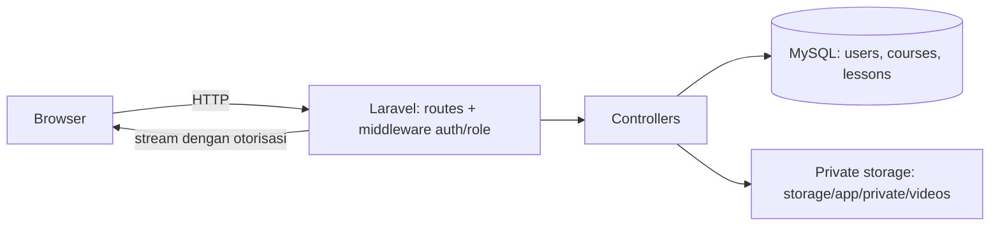
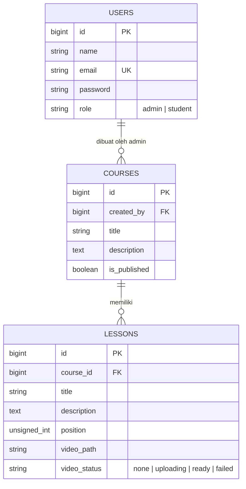
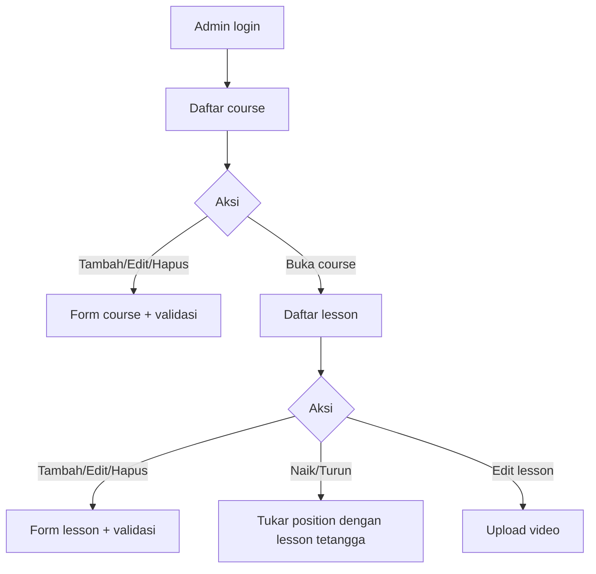
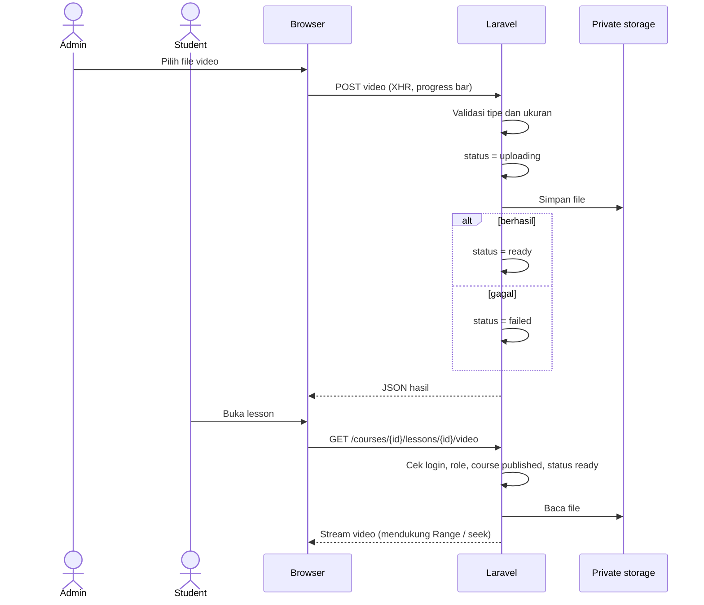

# Dokumen Desain

## 1. System design

Komponen utama:
- **Laravel** menangani routing, autentikasi (Breeze), otorisasi per role (middleware `role`), validasi, dan rendering Blade.
- **MySQL** menyimpan user, course, dan lesson (termasuk path dan status video).
- **Private storage** menyimpan file video di luar folder `public`, sehingga tidak ada URL langsung ke file.

## 2. ERD

## 3. Alur pengelolaan course dan lesson (Admin)

## 4. Alur upload dan pemutaran video

## 5. Keputusan desain dan asumsi

- Satu user memiliki satu role (kolom `role`), tanpa tabel roles terpisah agar tetap sederhana. Pendaftaran publik hanya menghasilkan Student; role Admin hanya dari seeder.
- Student hanya melihat course berstatus published. Course draft menghasilkan 404, bukan 403, agar keberadaannya tidak terbuka.
- Admin boleh memutar video semua course (untuk preview).
- Video dibatasi MP4 dan WebM, maksimal 200 MB, karena kedua format ini diputar langsung oleh browser tanpa transcoding.
- Pengurutan lesson memakai kolom `position`. Lesson baru otomatis menempati urutan terakhir; tombol naik/turun menukar posisi dengan lesson tetangga dalam satu transaksi.
- Menghapus lesson atau course ikut menghapus file video dari storage.
- Menghapus course menghapus seluruh lesson-nya (cascade).
- Upload memakai satu request XHR. Status `uploading` terlihat singkat karena file diterima penuh dulu baru disimpan.

## 6. Keterbatasan

- Upload tidak bisa dilanjutkan (resume) bila koneksi terputus; harus diulang.
- Tidak ada transcoding, thumbnail, atau durasi video (sesuai batasan assessment).
- Status `uploading` tidak dibersihkan otomatis bila proses PHP berhenti di tengah upload; admin perlu mengunggah ulang.
- Belum ada pelacakan progres belajar student, pendaftaran ke course, atau pencarian.
- Pengurutan lesson memakai tombol naik/turun, belum drag-and-drop.
- Pengujian otomatis masih minim (lihat bagian pengujian jika ditambahkan).
